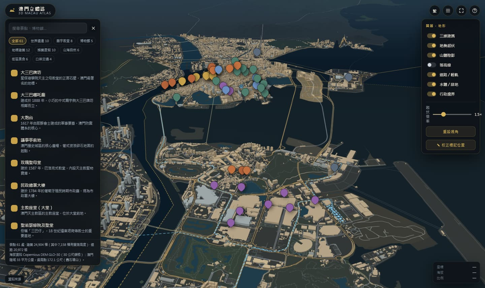

<div align="center">

# 澳門立體誌 · 3D Macau Atlas

**以開放資料建構的 3D 立體澳門地圖** — OpenStreetMap × Overture Maps × Copernicus DEM × 博物館文物三維掃描

[](https://maplibre.org/) [](https://threejs.org/) [](https://vitejs.dev/) [](LICENSE) [](#資料來源與授權)



**24,904 棟三維建築 · 172.1 公尺地形 · 61 個景點 · 7 個三維模型 · 最快路徑導航**

</div>

---

## 這是什麼

把**開放資料**變成一座可以在瀏覽器裡轉動、點選、導航的 3D 澳門：

- **地圖模型**：從 Overture Maps（含 OpenStreetMap）下載 24,904 棟建築、20,972 條道路、水體與土地利用，在 MapLibre GL JS 上以 3D 擠出呈現
- **海拔資料**：從 OpenTopography 下載 Copernicus DEM GLO-30（30 公尺網格），產生地形起伏、等高線與山體陰影；澳門陸域最高點 172.1 公尺（路環疊石塘山）
- **文物模型**：把高精度掃描檔（唐三彩雙峰駱駝俑、明永樂青花葫蘆扁瓶）與 5 座地標建築模型放進地圖，點擊即可開啟三維檢視器
- **導航**：以真實路網計算最快路徑，附「搜尋最快道路」的波前動畫與車流效果

> 所有資料都已隨附在 `public/`，clone 下來就能直接跑，不需重新下載。

---

## 預覽

`preview/` 內附 24 張實際執行截圖：

| 檔案 | 內容 |
| --- | --- |
| `01-全景-3D澳門` | 立體澳門全景 |
| `02-大三巴-三維建築`、`04-路氹城-度假村群` | 3D 建築細節 |
| `03-路環疊石塘山-地形`、`05-等高線與地形` | 地形與等高線 |
| `06-博物館與文物列表`、`07`、`08` | 博物館與文物三維檢視器 |
| `12`–`16` | 旅遊塔／科學館／巴黎人／銀河／倫敦人模型與介紹（左模型、右文字） |
| `18-地名標籤與周邊設施`、`19-低縮放標記去雜亂` | 標籤、POI、標記分層 |
| `22-個人定位` | GPS 藍點與精度圈 |
| `26`–`28` | **導航：搜尋動畫 → 路線與車流 → 路線指引** |
| `24`、`25` | 可平移範圍與邊界 |

---

## 快速開始

```bash
npm install                 # 安裝依賴（vite / maplibre-gl / three / gltf-transform）
npm run dev                 # 開發伺服器 http://127.0.0.1:5173
npm run build && npm run preview   # 打包並預覽 http://127.0.0.1:4173
```

Windows 可直接雙擊 **`啟動澳門立體誌.bat`**（自動打包＋開伺服器＋開瀏覽器）。

### 重新產生資料（可選）

```bash
npm run data        # 全部重建：Overture 圖資 → 地形磚 → Copernicus DEM → 景點座標 → 合併 OSM 高度
npm run models      # 重新優化三維模型（需要原始掃描檔）
npm run verify      # 檢查景點座標是否落在建築物／水域（QA）
```

| 指令 | 內容 | 產出 |
| --- | --- | --- |
| `npm run data:overture` | Overture Maps 圖資（建築、道路、水體、土地利用、邊界、POI） | `public/data/macau-*.geojson` |
| `npm run data:dem` | terrarium 地形圖磚下載＋清除海底異常值 | `public/dem/**`（683 張） |
| `npm run data:cop30` | Copernicus DEM GLO-30 下載＋高程統計＋等高線＋山體陰影 | `public/data/elevation/*` |
| `npm run data:geocode` | Wikipedia／Wikidata 權威座標 | `.cache/geocode.json` |
| `npm run data:poi` | 景點資料編譯（座標四層解析、標籤、POI 精簡檔） | `public/data/attractions.json` |
| `npm run data:osm` → `data:merge` | 用 OSM `building:levels` 補上更多實測高度 | 更新 `macau-buildings.geojson` |

> 需要 Python 的 `overturemaps` CLI 與 OpenTopography API key（見 `scripts/fetch-opentopography.mjs`）。

---

## 功能總覽

### 3D 地圖
- 24,904 棟建築以 3D 擠出呈現，高度分「實測」（`height`／`building:levels`）與「依類型推估」兩級
- 可切換：三維建築、地勢起伏（1.0–3.0 倍）、山體陰影、等高線、道路／輕軌、水體與綠地、行政邊界
- 滑鼠拖曳平移、右鍵拖曳旋轉傾斜、滾輪縮放；**可平移範圍＝澳門＋約 6 公里緩衝（21.5 公里見方）**，最低縮放依視窗自動調整，任何縮放都能左右上下移動
- 離開範圍時下方出現「**回到澳門**」浮動鈕

### 內容與標註
- **61 個景點**分 8 類（世界遺產、廟宇教堂、博物館、地標、娛樂度假、山海自然、街區美食、口岸交通），座標以「同名建築詞級比對 → 權威座標互相佐證 → 人工座標」四層解析，其中 35 個精確落在對應建築輪廓內
- **地名標籤 251 個**（區域 6、堂區 8、公園海灘 68、主要街道 171）：DOM 標籤＋螢幕碰撞剔除，依縮放分層出現，點擊可飛到該處
- **周邊設施 6,569 筆**，分 9 類可勾選；餐飲／購物預設關閉，低縮放只顯示核心類別（文化／交通／政府／醫療／住宿），點圓點顯示名稱
- **標記去雜亂**：依重要度分三層，低縮放只顯示世界遺產／博物館／地標／有 3D 模型者

### 個人定位
- 右上角定位圖示三段式：**定位 → 跟隨 → 停止**；藍點＋GPS 精度圈，有方向資料時顯示箭頭（隨地圖旋轉校正）
- 景點詳情顯示「距離你 X 公尺（方位）」；側欄「📍 附近」依距離排序
- 需瀏覽器允許位置權限，**僅在 HTTPS 或 localhost 可用**

### 導航（最快路徑）
- 景點詳情按「🧭 導航到這裡」→ 以你的位置為起點（未開定位時以地圖中心代替）
- **搜尋動畫**：光點依 Dijkstra 造訪順序波前擴散（青→金），呈現「搜尋所有可能道路」的過程
- **定案動畫**：探索淡出、金色霓虹路線由起點長出（外光暈＋白色核心線）
- **車流動畫**：26 個光點沿路線流動，終點脈衝圈
- 依距離自動選**步行／開車**（< 2.5 km 步行），可手動切換；附**逐段路線指引**（左右轉圖示＋街名＋距離）
- 實測：大三巴 520 m／步行 7 分、旅遊塔 1.9 km／步行 25 分、黑沙海灘 11 km／開車 16 分

### 其他
- **全站全螢幕**（右上角圖示或 **F**）、文物檢視器另有獨立全螢幕
- **標記位置校正**：圖層面板按「✎ 校正標記位置」可直接拖曳標記，修正存於瀏覽器並可「匯出校正檔」
- **深連結**：網址即時反映鏡頭與選取景點（`#16.20/22.17982/113.53680/spot/macau-tower`）
- **快捷鍵**：`L` 圖層面板、`S` 景點清單、`F` 全螢幕、`Esc` 關閉面板／結束導航
- **繁簡切換**（opencc-js 動態載入）

---

## 部署（GitHub Pages）

已內建 GitHub Actions：推送 `main` 即自動 `npm ci → npm run build → 部署 dist`。

1. 到 **Settings → Pages → Build and deployment → Source** 選 **GitHub Actions**
2. 推送後約 1–2 分鐘即可在網址看到（自訂網域請於 Pages 設定 Custom domain 並開啟 Enforce HTTPS）
3. 產物包含 `public/` 全部圖資、地形與模型（約 76 MB），**完全靜態、離線可跑、無需伺服器**

> 站台以自訂網域根目錄提供服務，因此程式中的絕對路徑（`/data/…`、`/dem/…`、`/models/…`）可直接運作。
> 若改用 `帳號.github.io/專案名/` 子路徑，請把 `vite.config.js` 加上 `base: "/專案名/"` 並將程式內路徑改為相對路徑。

---

## 資料來源與授權

| 資料 | 來源 | 授權 |
| --- | --- | --- |
| 建築、道路、土地利用、水體、POI、行政邊界 | [Overture Maps Foundation](https://overturemaps.org)（含 OpenStreetMap 與 Microsoft ML 建築足跡） | ODbL 1.0／Overture 授權，需標示 © OpenStreetMap contributors |
| 海拔 | **Copernicus DEM GLO-30**，經 [OpenTopography](https://opentopography.org) Global DEM API | © DLR e.V. 2010-2014 / © Airbus Defence and Space GmbH 2014-2018, provided under COPERNICUS by the EU and ESA |
| 即時地形圖磚 | Terrain Tiles（AWS Open Data / Mapzen，terrarium 編碼） | Public domain / CC-BY |
| 三維模型 | 專案作者提供之高精度掃描與 AI 生成檔 | 僅供學習研究使用，版權歸原提供者 |
| 程式框架 | MapLibre GL JS（BSD-3）、three.js（MIT）、Vite（MIT）、opencc-js（MIT） | 見各套件授權 |

**海拔重點數字**：澳門陸域面積約 **33 平方公里**、最高點 **172.1 公尺**（路環疊石塘山）、平均高程 20.6 公尺；等高線以 5 公尺間距共 9,956 條。

---

## 導航是怎麼算的

```
OSM/Overture 路網 (public/data/macau-roads.geojson, 20,972 段)
  → 客戶端建圖：6 公尺內重複節點合併（含交叉路口）＋ 連通分量過濾
      步行 53,246 節點 / 55,706 邊　　開車 29,005 節點 / 31,596 邊
  → Dijkstra（權重＝預估行進時間，非距離）
      步行：footway 4.8／steps 2.6 km/h…　開車：motorway 65／primary 45／residential 25 km/h…
  → 回溯路徑 → 依街名合併為逐段指引（含左右轉判斷）
  → 動畫：① 造訪順序波前 ② 路線逐段繪出 ③ 車流光點
```

- 起訖點吸附最近道路節點（預設 500 公尺，失敗時自動放寬、並可換另一種交通方式）
- 計算只需 **4–10 毫秒**（客戶端即時運算，無需伺服器）
- **限制**：Overture 澳門路網沒有單行道屬性，開車路線未考慮單行；未計入即時路況；範圍僅限澳門

---

## 三維模型

| 模型 | 類別 | 檔案 | 原始檔 |
| --- | --- | --- | --- |
| 唐三彩雙峰駱駝俑 | 文物掃描（1:1） | `tang-sancai-camel.glb` 33 萬面 / 2.7 MB ＋ LOD | 76.6 MB / 150 萬面 |
| 明永樂青花輪花紋綬帶耳葫蘆扁瓶 | 文物掃描（1:1） | `yongle-blue-white-flask.glb` 33 萬面 / 2.4 MB ＋ LOD | 72.4 MB / 150 萬面 |
| 澳門旅遊塔 | 地標建築（AI 生成） | `macau-tower.glb` 27 萬面 / 2.3 MB ＋ LOD | 62.0 MB / 193 萬面 |
| 澳門科學館 | 地標建築 | `macau-science-center.glb` 27 萬面 / 2.4 MB ＋ LOD | 61.5 MB / 190 萬面 |
| 澳門巴黎人 | 娛樂度假 | `parisian.glb` 27 萬面 / 3.1 MB ＋ LOD | 65.4 MB / 190 萬面 |
| 澳門倫敦人 | 娛樂度假 | `londoner-macao.glb` 27 萬面 / 2.3 MB ＋ LOD | 56.5 MB / 190 萬面 |
| 澳門銀河 | 娛樂度假 | `galaxy-macau.glb` 26 萬面 / 2.7 MB ＋ LOD | 57.7 MB / 189 萬面 |

處理流程：`weld → simplify(meshoptimizer) → textureCompress(WebP 2048) → quantize → meshopt(EXT_meshopt_compression) → prune`，
並輸出 `.lod.glb`；檢視器採**左模型、右介紹文字**，先載 LOD 再換高精度版本。

### 加入自己的文物模型
1. 把 `.glb` 放進 `public/models/`（Draco 壓縮檔亦可，已附解碼器）
2. 在 `public/models/manifest.json` 加一筆（`file`、`bytes`、`triangles`、`dimensionsMeters`）
3. 在 `scripts/attractions.data.mjs` 的 `ARTIFACTS` 加入文物（`model: "my-artifact"`），並在博物館 `artifactIds` 引用
4. `npm run data:poi && npm run build`

---

## 專案結構

```
├─ index.html                  應用外殼（地圖、側欄、檢視器、導航列）
├─ src/
│  ├─ main.js                  主流程：地圖、標記、面板、圖層、深連結、定位、導航接線
│  ├─ map-style.js             MapLibre 樣式（向量底圖 + 3D 建築 + 地形 + 等高線延遲載入）
│  ├─ markers.js               景點標記（分層顯示、可拖曳校正）
│  ├─ labels.js                地名標籤層（DOM + 碰撞剔除）
│  ├─ pois.js                  周邊設施圖層（分組、縮放分層、點擊小卡）
│  ├─ geolocate.js             個人定位（GPS 藍點、精度圈、距離方位）
│  ├─ routing.js               路網建圖 + Dijkstra + 逐段指引
│  ├─ navigation.js            導航控制與三段動畫
│  ├─ viewer.js                three.js 模型檢視器（LOD → 高精度）
│  ├─ icons.js / i18n.js       圖示、繁簡轉換
│  └─ styles.css
├─ scripts/                    資料管線（Node ESM）＋ dev/ 驗證工具
├─ public/
│  ├─ data/                    GeoJSON、景點、標籤、高程資料（約 21 MB）
│  ├─ dem/                     地形圖磚 z10–15（683 張 / 24 MB）
│  ├─ models/                  7 個 GLB ＋ manifest（24.7 MB）
│  └─ draco/                   Draco 解碼器
└─ preview/                    24 張執行截圖
```

---

## 效能

| 項目 | 數值 |
| --- | --- |
| 首次就緒 | 約 3.8 秒（headless 軟體渲染；等高線 4.3 MB 延遲載入後由 5.4 秒降下） |
| 單次瀏覽傳輸 | 約 8.4 MB（地形圖磚 6 MB、周邊設施 1 MB、GeoJSON 與程式 0.5 MB） |
| 路線計算 | 4–10 毫秒（客戶端 Dijkstra，步行 5.3 萬節點／開車 2.9 萬節點） |
| 3D 建築 | 24,904 棟，依視野自動分塊載入 |
| 模型 | 7 個，每個 2.3–3.1 MB ＋ LOD 0.6–1.5 MB |

---

## 已知限制

- 建築高度以 `height`／`num_floors` 為主，沒有的依類型推估（約 71%）；天際線為「合理推估」
- 地形為 30 公尺網格資料，平坦市區的起伏靠誇大倍率呈現；海底高程已壓平為 0
- 開車導航未考慮單行道（資料缺）；導航範圍僅澳門路網
- 個人定位需 HTTPS 或 localhost；桌機無 GPS 時以 Wi-Fi 推估，誤差可能達數百公尺（已顯示精度圈）
- 地名標籤與周邊設施仍在完善中，部分名稱取自 OSM，可能有缺漏或誤植

---

## 後續優化 · Roadmap

### 短期
- [ ] **日夜光影切換**：`map.setLight()` 方位與色溫，夜間讓建築窗戶發光
- [ ] **PWA 可安裝離線**：Service Worker 快取地圖、地形與模型
- [ ] **手機版底部抽屜**：詳情面板改為可拖曳 bottom sheet，放大標記熱區
- [ ] **降低推估高度比例**：用 OSM `building:levels` 把實測比例由 29% 提升到約 59%（`npm run data:osm && npm run data:merge`）
- [ ] **校正流程自動化**：`npm run apply-fixes` 把匯出的 `macau-coord-fixes.json` 寫回資料檔

### 中期（體驗與內容）
- [x] ~~步行路線規劃~~ → **已完成**（含開車模式、最快路徑動畫、逐段指引）
- [ ] **導航進階**：單行道、即時路況、多點行程、大眾運輸（輕軌／巴士）與語音播報
- [ ] **英文／葡文介面**：資料已有 `name:en` / `name:pt`
- [ ] **景點照片與語音導覽**：補上授權照片（Wikimedia Commons）與語音介紹
- [ ] **更多文物模型**：持續擴充博物館館藏三維掃描
- [ ] **歷史時間軸**：老照片／歷史地圖對照今日 3D 城市
- [ ] **主題路線**：世界遺產步行路線、美食路線一鍵展開

### 長期（技術深度）
- [ ] **更精細的城市模型**：屋頂形狀、3D Tiles／CityGML
- [ ] **即時資料**：巴士到站、輕軌班次、人流
- [ ] **室內導覽**：博物館室內 3D 平面與文物定位
- [ ] **測試與 CI**：資料管線與前端單元測試，GitHub Actions 自動建置與部署 GitHub Pages
- [ ] **向量圖磚化**：24,904 棟建築改以 PMTiles 提供，首屏更快

---

## 授權

- **程式碼**：MIT（見 [LICENSE](LICENSE)）
- **資料**：各自授權，使用時請保留標示（見上方「資料來源與授權」）
- **引用**：`Linference (2026). 澳門立體誌 3D Macau Atlas. https://github.com/Linference/macaumemory`
